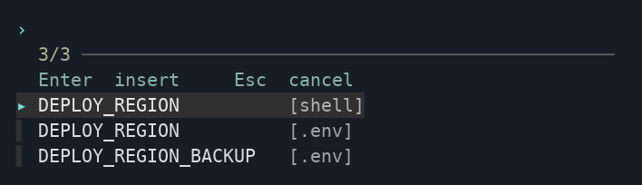

# token-completion

Type `$REG` in a zsh command and press **Tab**. A single match drops straight into the line. If shell variables, project-local settings, or other providers offer several matches, the picker shows who supplied each one. Type to narrow the list, press **Enter** to insert, or **Escape** to return to your original line.



Your command stays editable. The picker displays names and sources only. Your usual completion widget still handles filenames, unsupported quoting, command positions, and tokens with no match.

## Try it

From a checkout, start a disposable shell and source the plugin:

```zsh
zsh -f
source ./token-completion.plugin.zsh
DEMO_REGION='North America'
```

Now **type** `print -r -- $DEMO_REG` and press Tab. The resulting line is `print -r -- "$DEMO_REGION"`. Press Enter to execute it. You can also type `print --region=$DEMO_REG` and complete just the value to produce `print --region="$DEMO_REGION"`.

To try a collision, stay in that shell and create a scratch directory:

```zsh
cd "$(mktemp -d)"
print -r -- 'DEMO_REGION="South Pacific"' > .env
```

Complete `print -r -- $DEMO_REG` again and pick `[.env]`. The editable result is `print -r -- "$(token-completion dotenv DEMO_REGION)"`. A history replay reads the `.env` file in the directory where the replay runs.

## Dependencies

For a source installation, put the commands you need on `PATH`. The Nix package supplies the helper executables. The table gives the lowest versions verified on Linux for each role.

| Dependency | Minimum verified version | When you need it |
| --- | --- | --- |
| zsh | 5.9 | The Tab widget runs in interactive zsh with ZLE enabled. |
| fzf | 0.52.1 | Filters NUL-delimited candidates and displays the picker when several match. |
| Python 3 | 3.10.15 (3.10 series) | Reads dotenv keys and values, manages provider pins, and verifies cached GitHub providers. The standard library is sufficient. |
| Git | 2.44.1 | Clones a source installation and fetches GitHub providers during explicit install or update. Completion from a verified cache works offline. |
| Python 3 for tests | 3.11.9 (3.11 series) | The terminal tests use `termios.tcsetwinsize` to size a disposable PTY. |

## Installation and updates

Use `stable` for released changes or `development` for ongoing development. Version tags such as `v0.1.0` select a fixed release. After an update, open a fresh interactive shell and run `token-completion providers list` to verify loading.

### Manual

```zsh
plugin_dir="${XDG_DATA_HOME:-$HOME/.local/share}/zsh/token-completion"
git clone --branch stable https://github.com/randallwick/token-completion.git "$plugin_dir"
```

Add this after completion initialization in `.zshrc`:

```zsh
source "${XDG_DATA_HOME:-$HOME/.local/share}/zsh/token-completion/token-completion.plugin.zsh"
```

Replace `stable` in the clone command to choose another channel or a version tag. Update a channel checkout with `git -C "$plugin_dir" pull --ff-only`. In a fixed checkout, fetch tags and explicitly select the desired release.

### Oh My Zsh

```zsh
plugin_dir="${ZSH_CUSTOM:-${ZSH:-$HOME/.oh-my-zsh}/custom}/plugins/token-completion"
git clone --branch stable https://github.com/randallwick/token-completion.git "$plugin_dir"
```

Add `plugins+=(token-completion)` after your plugins array and before sourcing `oh-my-zsh.sh`. Custom plugin checkouts use the same channel or tag update commands as a manual install. [Oh My Zsh custom plugins](https://github.com/ohmyzsh/ohmyzsh/wiki/Customization)

### Antidote

Add `randallwick/token-completion branch:stable` to `.zsh_plugins.txt`, then use your usual `antidote load`. To advance channel checkouts, run `antidote update`. Use `branch:development` for the development channel, or `pin:<full-commit-SHA>` for the commit of a fixed release. [Antidote bundle options](https://antidote.sh/options) · [Antidote commands](https://antidote.sh/commands)

### NixOS or Home Manager

Add the plugin as a source input in your flake:

```nix
inputs.token-completion = {
  url = "github:randallwick/token-completion/stable";
  flake = false;
};
```

In a Home Manager module that receives `inputs`:

```nix
{ inputs, pkgs, ... }:
let
  plugin = pkgs.callPackage (inputs.token-completion + "/package.nix") {};
in {
  programs.zsh.enable = true;
  programs.zsh.plugins = [{
    name = "token-completion";
    src = plugin;
    file = "share/token-completion/token-completion.plugin.zsh";
  }];
}
```

For a NixOS configuration with Home Manager, the zsh plugin belongs in the user's Home Manager module. For system zsh without Home Manager, use the same package and add `source ${plugin}/share/token-completion/token-completion.plugin.zsh` to `programs.zsh.interactiveShellInit`. If other widgets wrap Tab, load this plugin after the widget it should use as its fallback and before any widget that should wrap it.

The input URL selects the branch or release tag. `flake.lock` records an exact revision. `nix flake update token-completion` advances the pin; a normal rebuild/activation makes that revision available to new shells. [Home Manager zsh plugin fields](https://nix-community.github.io/home-manager/options/home-manager/programs/zsh.html)

## Configuration reference

Set shell variables before sourcing the plugin in `.zshrc`. The provider array is a zsh array in the current shell; it need not be exported.

| Setting | Accepted value | Default |
| --- | --- | --- |
| `TOKEN_COMPLETION_PROVIDERS` | Ordered array of provider IDs, absolute local provider files or GitHub references | Shell, dotenv and compatible providers defined in the shell. An explicitly empty array disables all providers. |
| `TOKEN_COMPLETION_CONFIG_DIR` | Directory containing `providers.lock` | `${XDG_CONFIG_HOME:-$HOME/.config}/token-completion` |
| `XDG_CACHE_HOME` | Base directory for downloaded provider checkouts | `$HOME/.cache`; the plugin uses the `token-completion` subdirectory |
| `TOKEN_COMPLETION_PROMPT` | Literal picker prompt, read each time the picker opens. Set to an empty string to hide it. | `› ` (chevron and space) |
| `NO_COLOR` | Set to a nonempty string to disable decorative color | Use the terminal theme with an accent on the prompt and selection. Piped CLI output is plain. |

**Use just the project-local source.** Put `TOKEN_COMPLETION_PROVIDERS=(dotenv)` before loading the plugin. An installed plugin that exports a compatible named provider can join the array by ID, in either load order. Its own settings and data remain with that plugin.

**Use a working tree.** Add a local file by its absolute path. This example selects the shell and a provider under development:

```zsh
TOKEN_COMPLETION_PROVIDERS=(shell "$HOME/src/colors/provider.zsh")
```

**Use a remote provider.** Select a repository, a ref and the provider file in that repository. Substitute the coordinates of a provider you trust:

```zsh
TOKEN_COMPLETION_PROVIDERS=(shell dotenv 'github:OWNER/REPO@stable:providers/colors.zsh')
```

Run `token-completion providers install` after loading the plugin. To advance the locked revision, run `token-completion providers update`. A fresh shell or Tab lookup reads installed code offline. The lockfile can be versioned and reused with a fresh cache. Provider code runs with your shell's privileges. [Provider installation and lockfile details](docs/providers.md)

### Commands

| Command | Behavior |
| --- | --- |
| `token-completion --help` | Show the command summary. |
| `token-completion providers list` | Show configured providers, status and pinned GitHub revisions. |
| `token-completion providers install` | Resolve new entries, reuse existing pins and restore missing cached sources. |
| `token-completion providers update` | Resolve configured refs again and report old and new pins. |
| `token-completion dotenv KEY` | Print the current directory's literal value with no trailing newline. A missing key/file produces a diagnostic and a nonzero exit. An explicitly empty value succeeds quietly. |

### Dotenv grammar

The built-in dotenv provider reads `.env` on completion and again when an inserted lookup executes. It accepts single-line UTF-8 assignments, optional `export`, optional spaces around `=`, and single- or double-quoted literal values. A trailing comment follows a quoted value or starts with whitespace and `#` in an unquoted value. Dollar signs and backslashes are literal. Malformed lines are skipped, and the last assignment to a key wins. A missing lookup inside ordinary quoted command substitution still passes one empty argument to the surrounding command.

## Write a provider

Save this as `colors.zsh`, then add its absolute path to `TOKEN_COMPLETION_PROVIDERS`. The same functions can be exported by an existing zsh plugin; a user can select that provider by its ID.

```zsh
TOKEN_PROVIDER_ID=colors
typeset -g token_provider_colors_version=1

token_provider_colors_query() {
  emulate -L zsh
  local color
  for color in cerulean vermilion; do
    token_completion_emit "${(U)color}" palette "${(qqqq)color}"
  done
}
```

Type `print -- $CERU` and press Tab to insert a quoted literal. A provider can also insert a quoted parameter reference or a deferred lookup. The picker handles selection and zsh handles the inserted expression when the user executes the line.

| Interface | Contract |
| --- | --- |
| `TOKEN_PROVIDER_ID` | A file provider sets this to its shell-identifier ID while sourced. A provider already defined by name uses the identifier in its function names. |
| `token_provider_<id>_version` | Define as a global variable with the string value `1`. |
| `token_provider_<id>_query FRAGMENT` | Runs in the current shell. The fragment excludes the `$`. Emit zero or more candidates using the callback; the widget filters on the key. |
| `token_completion_emit KEY LABEL INSERTION` | Key is a shell identifier, label is human-readable provenance, insertion is the trusted zsh text to put into the buffer. Control characters in labels are sanitized. Different candidates may share a key and label. |
| `token_provider_<id>_prepare` | Optional function with no arguments. Return promptly. It runs once per enabled provider when available to completion. Late providers prepare at discovery; their query must work cold. |
| `token_completion_filter QUERY` | Filter NUL-delimited candidates from stdin using fzf. Matching records on stdout remain NUL-delimited. |

Keep provider files declarative at source time: installation may source them in a disposable shell to validate the interface. Put one-time setup in `prepare`. Use unique provider IDs; conflicting declarations receive a diagnostic from `providers list`. New shells pick up edits to local provider files.

## Development

From the checkout, run `python3 -m unittest discover -s tests -v` with zsh, Git, fzf and Python 3.11+ on `PATH`. Tests create disposable shell configurations, terminal sessions, provider repositories and caches. For interactive edits, start `zsh -f` in the checkout and source `./token-completion.plugin.zsh`; open a fresh disposable shell to pick up code changes.
